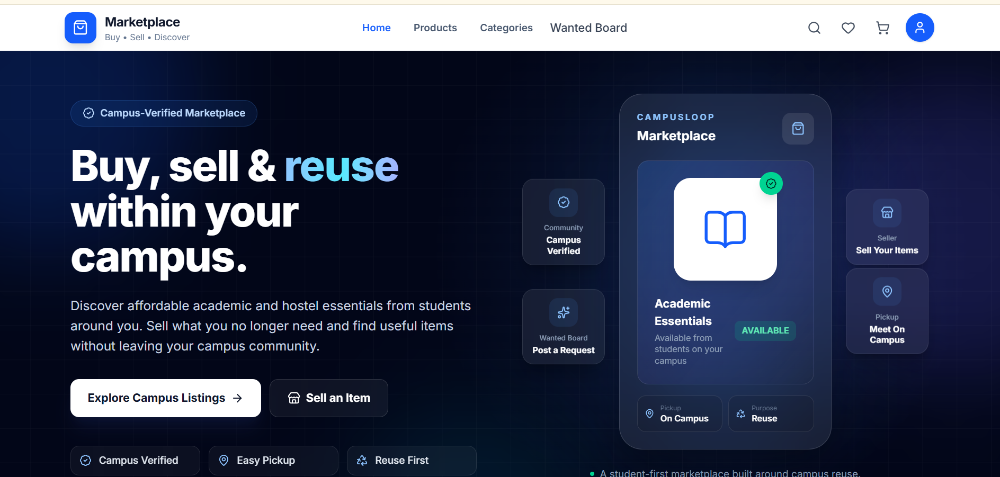

<!-- ==========================================================
     MANJARI TRIPATHI | GITHUB PROFILE README
     B.Tech CSE | 3rd Year
     ========================================================== -->

 

  

---

## 👩‍💻 About Me

Hey there! I'm **Manjari Tripathi**, a third-year B.Tech Computer Science Engineering student passionate about coding, problem-solving, and building technology-driven solutions.

- 🎓 B.Tech Computer Science & Engineering — 3rd Year.
- 💻 Core interests: Java, Data Structures & Algorithms, and Problem Solving.
- ⚙️ Backend Development: Spring Boot, REST APIs and application development.
- 🌐 Frontend Development: React.js, JavaScript, HTML and CSS.
- 🗄️ Databases: MySQL and MongoDB.
- 🤖 Exploring AI integration and intelligent applications.
- 🚀 Interested in innovative projects, scalable applications and open-source collaboration.

**My approach:** Learn the fundamentals, understand the problem, write clean code, and build something useful.

---

## 🔥 What I'm Working On

- Improving problem-solving skills through Java and DSA.
- Exploring backend engineering with Spring Boot.
- Developing full-stack applications.
- Learning better application architecture and database design.
- Experimenting with AI-powered application ideas.
- Building practical projects that solve real-world problems.

---

## 🛠️ Tech Stack

### Languages

### Backend Development

### Frontend Development

### Databases

### Tools & Platforms

---

## 🚀 Featured Repository

### 🏪 CampusLoop — Campus Marketplace

**A student-first marketplace to buy, sell and reuse items within a campus community.**

**Key Features**

- Campus-based product discovery.
- Buy, sell and manage product listings.
- Search, filter, sort and pagination.
- Wanted Board for student requests.
- Seller application and approval.
- JWT authentication and role-based authorization.
- Wishlist, cart and order management.

**Technologies:** Java | Spring Boot | React.js | MySQL | Spring Security | JWT | REST APIs

**What I explored:** Full-stack integration, backend architecture, database relationships, authentication, authorization and real-world application workflows.

---

## 💻 GitHub Statistics

  

---

## 📈 Contribution Activity

---

## 🐍 Contribution Snake

<picture>
  <source media="(prefers-color-scheme: dark)" srcset="https://raw.githubusercontent.com/manjariii8/manjariii8/output/github-contribution-grid-snake-dark.svg"/>
  <source media="(prefers-color-scheme: light)" srcset="https://raw.githubusercontent.com/manjariii8/manjariii8/output/github-contribution-grid-snake.svg"/>
  
</picture>

---

## 🌱 Beyond Coding

- 💡 Exploring creative approaches to real-world problems.
- 🤖 Interested in AI-powered software applications.
- 🧠 Improving logical thinking and problem-solving.
- 🌍 Interested in open-source development and collaboration.
- 📚 Learning new technologies and strengthening fundamentals.

---

## 🤝 Let's Connect

I'm always happy to connect with developers, exchange ideas, collaborate on projects, and learn from the developer community.

  

### ✨ Keep Learning. Keep Building. Keep Innovating.

